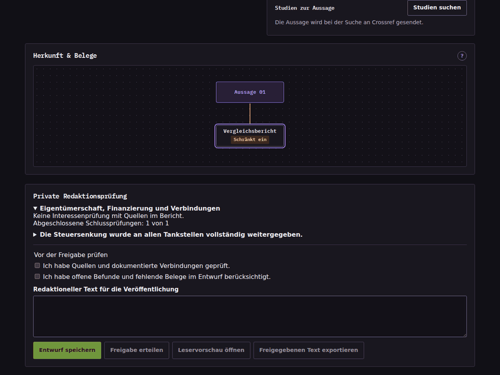
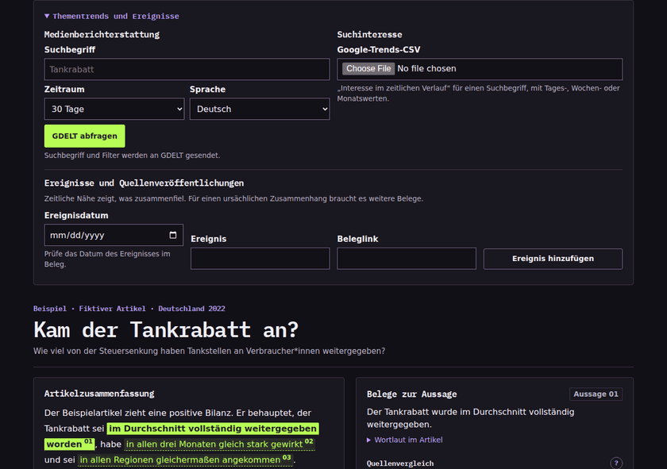
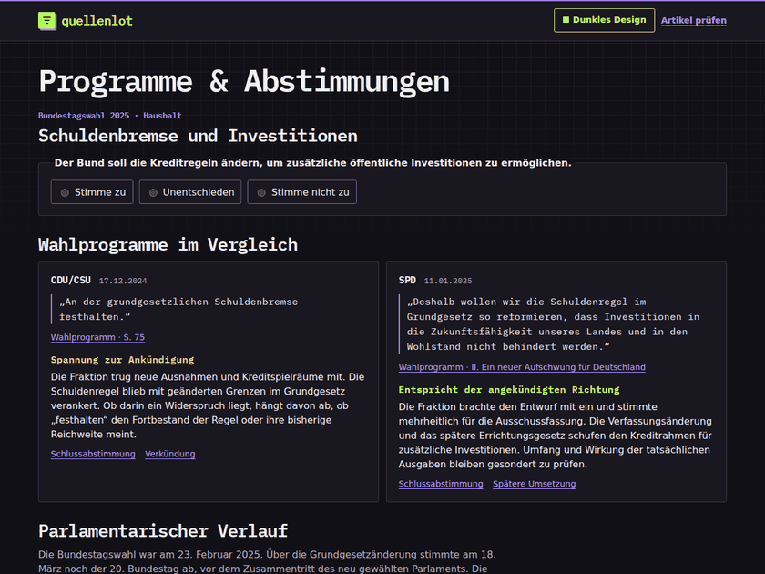

# Quellenlot

Quellenlot runs an evidence-first, multi-model review over supplied source snapshots or public article URLs. Inference runs locally through Ollama and requires no cloud model API, account, or API key.

## What you can do

Paste a German-language news article, optionally ask a question, and trace the review from the article's *actual words* through versioned comparison sources, independent local-model judgments, peer review, and a private editorial assessment. The reader chooses what to inspect; Quellenlot does **not** output a model-vote-based truth score.

| Capability | What to inspect |
| --- | --- |
| Article analysis | Up to five checkable claims, original quotations and a linked article summary |
| Sources & provenance | Explicit citations, separate publication/update/capture dates, missing and incomplete retrievals |
| Claim-by-claim comparison | Supporting, qualifying and conflicting assessments, exact quotations, RapidFuzz wording reuse and source-pair similarity |
| Multi-model review | Independent model findings, directed peer review, unresolved objections and recorded failures |
| Further research | Studies per claim, ownership/funding/affiliation checks and topic/event timelines |
| Political records | Curated programme statements, parliamentary votes, motions and subsequent laws |
| Editorial release | Private drafts, report-version-bound approval, reader preview and offline HTML export |

**Try without Ollama:** open [`web/index.html`](web/index.html) for the built-in Tankrabatt demonstration. **Run locally:** see [Quick start](#quick-start) for the Ollama-backed browser server. The source-linked demo and the controlled CI fixtures are demonstrations, **not a live fact-check or evaluation of model accuracy**.

## Interface walkthroughs

The repository tracks reproducible **25 fps browser GIFs** and desktop/mobile screenshots. These clips show GUI interactions with demo or fixture-backed data; they do not indicate that the models ran at 25 fps. The [complete feature gallery](web/README.md#feature-gallery) has all screenshots and walkthroughs, and the [capture manifest](docs/images/generated/manifest.json) identifies each tested commit and file hash.

Start with the [Tankrabatt demo walkthrough](web/README.md#what-to-look-for-in-the-tankrabatt-demo) to follow the claim about full average pass-through through its source comparison and understand how a saved report appears in the KI-Plenum.

### 1. Follow a claim to its cited evidence


Select a highlighted claim, inspect source judgments and direct quotations, then follow the provenance graph to see which reports refer to a shared upstream source. Publication, modification and retrieval timestamps are **different fields**. A link or similar wording does not, by itself, establish copying or independent corroboration.

### 2. Watch the five agent roles


**Agenten im Prüfverlauf** shows the currently active stage when a local analysis runs. Each of the five cards links to its available results. The interests stage is optional, and missing evidence is shown rather than silently treated as a successful check. [Role descriptions and status labels](web/README.md#agent-roles).

The role cards also offer **Einzelbeiträge** to inspect actual model attempts, model names, failures, reviews, and documented source-search operations without confusing deterministic retrieval for AI activity. [Agent inspector screenshots and walkthrough](web/README.md#agent-roles).

### 3. Examine model disagreement in the KI-Plenum


Instead of collapsing disagreement into a single verdict, the Plenum preserves each model's independent findings and the outcome of the directed review. Check both whether a quotation occurs in a snapshot and whether the quoted passage actually justifies its interpretation. [Plenum guide](web/README.md#ki-plenum).

<details>
<summary><strong>More walkthroughs: comparisons, research, topic trends and parliamentary records</strong></summary>

**Claim comparisons and potential text reuse:** inspect a source-by-source diff, dated versions, changed wording and article-pair similarity. A high similarity score is a *text-overlap measurement*, not proof of copying.


**Studies for one claim:** compare paper metadata, available abstract/full text, measured populations and periods, and the quotation on which a model's assessment rests.



**Topic trends and events:** compare separately scaled media coverage and search-interest series and place independently sourced events onto the timeline. Coincidence is not causation.



**Party programmes and parliamentary records:** follow dated programme excerpts, official vote tallies, parliamentary context and later legislative action.



</details>

### Desktop and mobile


[Mobile screenshot](docs/images/generated/mobile.png) · [320 px light-theme preview](docs/images/generated/light-mobile.png) · [Full feature gallery](web/README.md#feature-gallery)

## How the five-stage review works

Each stage has a distinct responsibility. **A stage is a workflow role, not necessarily a separate model process.** Five configured Ollama models are reused sequentially across model-driven tasks; deterministic code handles retrieval, quotation matching and textual similarity.

| Role shown in the GUI | Mechanism | Evidence retained |
| --- | --- | --- |
| **1. Behauptungsanalyse** | Try models in order until one supplies a valid extraction; optionally prioritise the reader's question | Up to five claims anchored to verbatim article quotations, summary links and failed extraction attempts |
| **2. Quellenrecherche** | Capture supplied URLs or use configured SearXNG to discover comparisons; traverse explicit links | Versioned text snapshots, retrieval failures, publication and update metadata, citation links, search provenance |
| **3. Quellenvergleich** | Ask each of five models to assess each claim independently, then cross-review successful findings | Per-source relations, original reasons and exact quotes, model disagreements, peer-review outcomes and RapidFuzz overlap |
| **4. Interessenprüfung** *(optional)* | Investigate documented publisher/author ownership, funding and affiliations when enabled | Captured evidence, per-model findings, unresolved categories and retrieval gaps |
| **5. Redaktionelle Schlussprüfung** | Five models independently assess assigned evidence findings; editorial release remains a human decision | Finding coverage, supported notes, prior dissent, missing evidence and a private draft/approval record |

Model-generated responses are not trusted merely because several models agree. Exact quote matching establishes only that specified words appear in the saved text. **It does not validate their factual accuracy, context, independence or relevance to the claim.** The public reader edition requires explicit human approval of an unchanged saved report and the drafted text.

During a local analysis the GUI highlights the active stage. After a completed or partial analysis, a stage card leads to the relevant saved evidence. The optional interests check may not run; older imported reports may lack newer fields. [Detailed stage and GUI behavior](web/README.md#agent-roles).

### Local model execution

Models run sequentially. Each Ollama request sets `keep_alive=0` to unload the model after responding, so the whole pool need not fit in memory simultaneously. The default context limit is 8,192 tokens (configurable up to 16,384); long reports and model generation can still be CPU- and RAM-intensive.

The example pool in [`config.example.toml`](config.example.toml) is **not** a validated ranking: Qwen3.8 27B, gpt-oss 20B, Mistral Small 3.2 24B, Gemma 4 12B, and Ministral 3 14B. Model weights must be downloaded once. The largest example download is approximately 18 GB; model context and the OS consume additional memory. Inspect the individual model licenses before redistribution or commercial use.

## Quick start

Requires Python 3.12+ and a running local Ollama server. Run the setup from the repository root.

```bash
python -m venv .venv
. .venv/bin/activate
python -m pip install -e .
cp config.example.toml models.toml
```

Pull the models listed in `models.toml` using the commands in [config.example.toml](config.example.toml). The first download requires internet access.

To start a saved browser analysis, run `quellenlot-ui --config models.toml` and open `http://127.0.0.1:8765`. Paste the article URL and any comparison URLs, add a question if needed, and select **Analyse starten**. The [GUI guide](web/README.md#using-the-local-agent) covers saved runs and report imports.

To run a standalone claim through the CLI, prepare an input JSON:

```json
{
  "case_id": "tankrabatt-001",
  "claim": "The fuel tax cut was fully passed on to consumers.",
  "sources": [
    {
      "source_id": "article-a",
      "version_id": "2026-11-18T09:00:00Z",
      "title": "Example source",
      "url": "https://example.org/article",
      "captured_at": "2026-11-18T09:00:00Z",
      "text": "Paste the relevant source text here.",
      "text_is_complete": true
    }
  ]
}
```

Run the analysis:

```bash
quellenlot-agents --config models.toml --input case.json --output report.json
```

A quote match proves only that the text appears in the supplied snapshot, not that it supports the reasoning. A failed model produces a partial report. Fewer than two successful analyses cannot produce peer review. If every model fails, the command exits nonzero.

### Article input

Use the same CLI command with JSON containing an `article` instead of an explicit `claim`. You can omit the question and submit just the article. To compare sources, add a `comparison_sources` array of snapshots using the same fields as `article`. Source IDs must be unique.

```json
{
  "case_id": "bibliothek-001",
  "article": {
    "source_id": "meldung",
    "version_id": "v1",
    "title": "Neue Bibliothek",
    "url": "https://example.org/meldung",
    "captured_at": "2026-11-18T09:00:00Z",
    "text": "Die Bibliothek öffnet am Montag. Der Eintritt ist frei.",
    "text_is_complete": true
  },
  "question": "Wann öffnet die Bibliothek?",
  "comparison_sources": [
    {
      "source_id": "stadt",
      "version_id": "v1",
      "title": "Information der Stadt",
      "url": "https://example.org/stadt",
      "captured_at": "2026-11-18T09:15:00Z",
      "text": "Die Bibliothek öffnet am Dienstag.",
      "text_is_complete": false
    }
  ]
}
```

Article reports can include an `article_summary` of up to three sentences drafted during claim extraction. Each sentence carries the ID of a distinct claim with a verified article quote. This is a summary of what the article says. A verified quote establishes that the passage appears in the article snapshot. The comparison and review results give the evidence assessment.

Each claim entry contains the original quote, a source comparison in input order, and the detailed review. The comparison groups judgments by source and links exact-match citations to the supplied URL and snapshot version. A judgment may have no exact-match citation. Incomplete snapshots are marked unassessable when a model would otherwise report an omission.

The detailed review holds the claim text, model disagreements, and peer review records. A peer review is successful only when it covers every assigned finding exactly once. If extraction finds no claims, the article report has status `no_claims`. Open **KI-Plenum** on a claim in the GUI to inspect the independent analyses, directed peer reviews, verified review quotes, and unresolved objections. [GUI guide](web/README.md#ki-plenum)

An article run can make up to ten model calls per extracted claim after extraction. Keep source snapshots short enough for the configured context length.

Sources record optional `published_at` and `updated_at` separately from `captured_at`. A manually supplied snapshot can include `"published_at": {"value": "2024-04-02"}`. Use an ISO date or timestamp and include the UTC offset when known. Missing dates are represented as `null`. The extraction, comparison, and peer-review prompts use the dates as context for time-sensitive claims and distinguish them from the times of events described in the article.

### Article URLs

Pass the same command a case with `article_url` and optionally `comparison_urls` and `question`.

```json
{
  "case_id": "bibliothek-url-001",
  "article_url": "https://example.org/meldung",
  "question": "Wann öffnet die Bibliothek?",
  "comparison_urls": ["https://example.org/stadt"]
}
```

The CLI fetches public HTTP(S) pages on the default ports and extracts readable text from static HTML. Each snapshot records the final URL and capture time. The JSON report records each attempted URL under `retrievals` and puts the article comparison under `review`. Failed comparison fetches leave the remaining sources available for review and mark the overall report `partial`. If the original cannot be fetched, the CLI writes the retrieval failure and exits with code 2.

Fetched text is always marked as having unverified completeness. The retrieval report also flags observable limits such as restricted access, a partial HTTP response, fallback to page text, or snapshot clipping. Omissions from these snapshots are reported as `not_assessable`. Use the text input mode to supply a complete snapshot you have verified. URL intake works with server-rendered HTML. Pages that require login, JavaScript rendering, or another document format may need text input.

For fetched pages, Quellenlot records explicitly declared dates and their provenance. It checks Article JSON-LD (`datePublished` and `dateModified`), then Open Graph article metadata, then labeled `<time>` elements within the article. If the highest-priority available channel gives conflicting values for a date, that date is left unknown. Date-only values remain dates, and timestamps without a UTC offset retain their unspecified timezone.

Each successful `retrievals` entry embeds the saved, versioned text under `snapshot`. Failed entries retain an attempt timestamp and the failure detail. Review quotes refer to a snapshot by source and version ID. When a quote occurs exactly once, `start` and `end` give its zero-based character offsets in that text, with an exclusive end. URL reports contain the captured article text and should be shared accordingly.

The URL workflow follows visible links from the extracted article or main content. It follows up to two hops and makes up to eight additional retrievals, giving priority within each hop to URLs linked by several sources. Redirect aliases and common tracking parameters are resolved when grouping shared targets. A link to an inaccessible page remains visible in the report, and `provenance.limited` records when traversal or link extraction reached a cap. These article-level links document where one page points to another. Claim-level support is assessed separately in `review`. Import the URL report into the GUI to inspect shared link targets and the exact text of the links.

### Automatic comparison search

To discover comparison sources from an article URL, add a `[search]` section to `models.toml` and omit `comparison_urls` from the input JSON. Supply a trusted [SearXNG endpoint](https://docs.searxng.org/dev/search_api) with JSON enabled in its `search.formats` settings. A locally hosted instance works without an API key.

```toml
[search]
endpoint = "http://127.0.0.1:8888/search"
language = "de-DE"
max_sources = 3
```

Quellenlot searches the extracted claims and, if supplied, the question anchored to the first claim. The configured search instance and its upstream search providers receive these queries. The search samples up to 20 results per query, gives preference to government and public institution domains in a fixed list, then tries up to twice `max_sources` URLs to capture unique articles. This preference is based on the publisher's domain. The normal evidence review assesses each captured source and its quotes.

The report lists the executed queries under `discovery.queries`, shows attempted candidates and selection outcomes under `discovery.candidates`, and records individual fetch failures under `retrievals`. Search failures and searches with zero usable comparisons produce a partial report when the original can still be reviewed. Explicit comparison URLs take precedence whenever you supply them.

### Studies for a claim

Start the [local browser interface](web/README.md#using-the-local-agent), reopen a saved analysis, and select a claim. **Studien suchen** searches Crossref and checks up to five candidate DOIs in Europe PMC. The selected claim and locally generated search terms are sent to Crossref. The first configured Ollama model reads the available text locally.

Each result links to the paper and identifies metadata-only, abstract, or full-text access. The interface marks when only excerpts entered the model and shows the supported fields with their exact quotations. A second configured Ollama model checks the study's relation to the claim and the proposed rationale before they appear. When the second check does not confirm the interpretation, the study card marks the relation as unclear and shows the source excerpts. Results are cached by claim alongside the saved run. See the [GUI guide](web/README.md#studies-for-a-claim) for the walkthrough.

### Shared wording

The `shared_wording` field appears in the standalone claim report or once on the article report (`review.shared_wording` for a URL case). Open **Textähnlichkeit der Quellen** below the source graph in the browser to compare every pair of captured articles. Each score links to the two source versions in `shared_wording.source_similarities`. [Browser guide and previews](web/README.md#source-article-similarity)

The score is the percentage of distinct five-token phrases that appear in both snapshots out of all such phrases in either snapshot (Jaccard similarity). It treats upper- and lowercase alike and counts repeated phrases once. Zero means the captures share no five-token phrases. A score of 100 means their phrase sets match. If either snapshot has fewer than 12 tokens, `score` is `null`. The browser flags captures whose completeness is unverified. Quellenlot calculates the score locally from the available text without an additional model call.

The `matches` list contains individual passage matches found with RapidFuzz. Each match contains excerpts from both source versions, their zero-based character offsets in those snapshots, and an ordered-token similarity score from 0 to 100. The ending offset is exclusive.

The matcher looks for lightly edited paragraphs, sentences, and quoted passages. It requires at least 12 tokens and a similarity score of 90. It samples up to 160 passage windows per source and reports up to three matches per source pair and 60 per case. The `limited` flag indicates when a candidate or reporting cap was reached.

Shared wording can come from syndication, attributed quotations, or a common press release. The article score measures wording, so independently phrased accounts of the same event can score low. The report retains all source findings so that additions, changes in numbers or wording, and distinct reporting are visible. Source publication, update, and capture dates describe the available snapshots. Establishing who first published a particular passage requires dated versions of the passage itself.

### Claim-level source diff

Each claim review includes a `source_diff`. In a standalone claim report it is at the top level. In an article report it is under each `claims[].review`. The diff keeps sources in input order, with publication and update dates, independent model judgments, and references to their verified quotes in an evidence table.

The evidence table groups identical quotes from multiple sources when their occurrences are inside a matched passage. Source-specific excerpts and variants stay visible, including quotes that combine reused wording with additional reporting. A citation with a unique location in its snapshot includes zero-based character offsets and any overlapping `shared_wording_match_indexes`. These indexes refer to the standalone report's `shared_wording.matches` or to the enclosing article report's list. Repeated occurrences in a single source leave the exact offsets unknown.

Model disagreements remain visible as separate judgments. An incomplete snapshot yields `not_assessable` when a model would otherwise label a claim omitted. Each row's evidence references cover verified citations from source analysis. Peer-review evidence and retrieval outcomes remain available in the detailed report.

### Publisher and author relationships

Set `check_interests = true` in the top-level `models.toml` configuration to run a separate interests investigation. When a SearXNG `[search]` section is configured, Quellenlot searches each available source's declared publisher and up to two named authors for ownership, funding, and affiliations. It captures up to three evidence pages per source, keeps the queries and retrieval outcomes, and asks all five local models to assess their contents sequentially. Without a search endpoint, the report records missing evidence.

Article inputs may also supply an `interest_evidence` list with `target_source_id` and a full `source` snapshot. URL inputs accept `interest_urls`, each with a `target_source_id` and `url`. For URL cases, use `article` for the original or an ID such as `comparison-1` for a supplied comparison URL. Explicit interest evidence is used in place of automatic discovery for that source.

The `interests` section of the article report records source metadata, retrieved evidence versions, search attempts, and each model's findings about ownership, funding, author affiliations, and political affiliations. Every reported relationship must cite an exact passage in an evidence snapshot that names both parties. Each model and source also lists categories that remain unresolved. A model failure remains visible. An exact quote match establishes that the text appears in the captured evidence. The reviewer still needs to verify the relationship and its editorial significance.

### Final editorial assessment

Article cases include an `editorial` section. For each claim it lists the verified comparison evidence IDs, sources without verified quotes, the underlying review status, and the number of unresolved disagreements. It links to the separate interests report by source ID and records incomplete snapshots and URL retrieval or discovery gaps.

When at least one claim has verified comparison excerpts, each of the five models receives up to three passages per eligible claim, with preference for covering conflicting, qualifying, and supporting judgments. The input marks shared wording, clipped excerpts, dates, and examples of unresolved dissent. Each model returns one note per eligible claim with evidence references and a follow-up check where warranted. The selected source findings have stable IDs. The model must return one outcome and explanation for each assigned finding. Missing, repeated, and foreign IDs or citations invalidate the response. The report records how many comparison findings stayed outside the editorial selection, carries the original dissent into the editorial coverage, and flags findings challenged or left unclear by any final reviewer. The source diff retains all model findings and verified excerpts.

The editorial status describes assessment coverage. Unresolved disagreements remain visible even when every assigned finding was reviewed. It is `complete` when every claim has comparison evidence, all five notes are available, and the earlier review, search, and retrieval stages finished without reported failures. An article with no verified comparison excerpt gets `no_comparison_evidence` and skips the additional model calls. The notes ask a human editor to verify interpretations and source independence before making any publication decision.

### Per-model performance metrics

A completed local run now stores one observation per Ollama call in `model_calls`: model name, task schema, success/failure, total wall time, and—when Ollama supplies them—prompt tokens, generated tokens, and generation duration. Open **Modellleistung · Laufzeit und Token** in the saved browser report to compare attempts grouped by model and role. The values are observations of this run, not benchmark rankings. Token/s is calculated only if generation counts and durations are available for every call in the row. No peak RAM value is fabricated: it is explicitly **Nicht erfasst**. CLI reports also include the call records; older reports do not.

[GUI metrics screenshots and 25 fps walkthrough](web/README.md#model-performance-metrics)

## Reading a Quellenlot result

**What the labels mean.** A claim can be marked as supported, qualified, contradicted, not covered, or not assessable from an incomplete capture. They are *model judgments about the saved evidence*, not certified true/false labels. Read the underlying passage, compare its subject, population and time period with the claim, and inspect unresolved objections in **KI-Plenum**.

**Where the evidence came from.** A URL result contains versioned capture text and a timestamp. `published_at`, `updated_at` and `captured_at` are separate; provenance links document explicit hyperlinks, not inferred first publication. When a page requires JavaScript, authentication or an unsupported format, retrieval can fail or return incomplete text. An apparent omission in such a source is not proof the original article omitted the fact.

**How to use the extras.** `Studien suchen` queries Crossref and Europe PMC for candidate DOIs; a candidate may be metadata-only, abstract-only or full text. `Thementrends und Ereignisse` uses GDELT for the *share of monitored articles matching a search*, and accepts one Google Trends CSV as an independently scaled relative-search series. The server's automatic source discovery requires a separately configured SearXNG instance. External lookup services receive the query terms described in the [browser guide](web/README.md), while local Ollama inference does not require a cloud model API.

**What becomes public.** The current server binds to `127.0.0.1`. Analysis reports, saved drafts, evidence, and approvals remain local unless you deliberately export or share them. Approval is bound to the exact report digest and draft revision; editing either invalidates the approval. There is currently **no hosted authentication or public publishing service**.

**Reproducibility and validation.** The [Python CI](.github/workflows/python-quality.yml) checks types, formatting, security, contracts and deterministic tests. [GUI preview CI](.github/workflows/gui-previews.yml) uses headless Chromium with demo and controlled fixtures to publish screenshots/GIFs. These tests verify software behavior but do not establish real-world fact-checking accuracy or German-language model reliability. A separate held-out evaluation and real-source audit are still required.

### CPU benchmark on the self-hosted Docker runner

The [dedicated benchmark workflow](https://github.com/fragilepeach/quellenlot/blob/codex/self-hosted-ollama-benchmark/.github/workflows/ollama-benchmark.yml) runs only on a self-hosted Linux x64 runner with the `docker` label. The benchmark uses three serial repetitions of a fixed Tankrabatt claim and comparison snapshots. The Docker volume `quellenlot-ollama-models` keeps model weights across runs; only missing models are pulled.

Open the [benchmark workflow runs](https://github.com/fragilepeach/quellenlot/actions/workflows/ollama-benchmark.yml) for execution status and the `quellenlot-ollama-benchmark` artifact. It contains plots, per-request timings and sampled Ollama process RAM, and saved reports when the requests complete. This fixed-claim benchmark measures runtime and response validation. Use the annotated evaluation below for agreement with reference judgments.

### Common setup issues

| Symptom | Check |
| --- | --- |
| Only the static demo appears | Launch `quellenlot-ui --config models.toml` and open `http://127.0.0.1:8765` rather than the HTML file |
| Models fail or are very slow | Confirm Ollama is running and that each configured weight is installed; check available RAM and context settings |
| No comparison sources are discovered | Supply comparison URLs explicitly or enable a reachable SearXNG endpoint with JSON search enabled |
| A page is missing evidence | Inspect **Abrufprobleme**; the HTML-only URL intake cannot handle every website or paywall |
| Study or trend results are unavailable | Those features require a network path to Crossref/Europe PMC or GDELT; importing a Google Trends CSV works in the browser |

## Research-quality evaluation

Run `quellenlot-eval` on saved reports and independently annotated claim/source labels to measure per-model coverage, agreement, missing findings, citation verification and relation confusion. Input SHA-256 hashes make repeated evaluations auditable. This is a **measurement harness**, not proof of model reliability; no real-world reference corpus is bundled. [Evaluation guide and label schema](docs/evaluation.md).

## Development checks

Update this README and any relevant feature guides in the same pull request as every new feature. Cover usage, configuration, and limitations that affect users. For GUI changes, refresh the affected screenshots and walkthroughs through the preview workflow.

```bash
python -m pip install -e ".[dev]"
pre-commit install
pre-commit run --all-files
python -m unittest discover -s tests -v
pip-audit
python -m build
twine check dist/*
```

The [Python quality workflow](.github/workflows/python-quality.yml) runs the full suite on pushes, pull request updates, merge-queue events, and manual runs. The checks cover every tracked Python source and stub, including tests and tooling, without a changed-file baseline or CI auto-fixes.

- Ruff enforces linting, formatting, annotations, and Google-style docstrings. The documentation contract checks descriptive summaries and applicable `Args`, `Returns`, `Yields`, and `Raises` sections for public APIs. It rejects explicit generic annotations and inline diagnostic suppressions.
- Pyright runs in strict mode with warnings treated as failures. Astral's ty enables every rule as an error.
- CrossHair checks exact peer-review coverage and how the workflow handles apparent omissions in incomplete sources. The symbolic coverage check uses assignments of up to three findings. Import Linter enforces the package layers, and Vulture checks high-confidence dead code.
- Actionlint, Zizmor, and Yamllint validate workflow definitions. CI also runs Bandit, the dependency audit, deterministic behavioral tests with fixture HTML and simulated Ollama responses, and the package build checks.

## Scope boundary

Quellenlot includes a local agent library, a CLI, and a loopback browser interface with saved runs, private editorial drafts, and report-specific approval. Run `quellenlot-ui --config models.toml` from the checkout to start an analysis from the browser. See the [GUI guide](web/README.md#using-the-local-agent) for setup and storage paths. Hosted access control and public publication remain separate work. Local model quality for German political research still needs evaluation against a held-out set before relying on the results.
