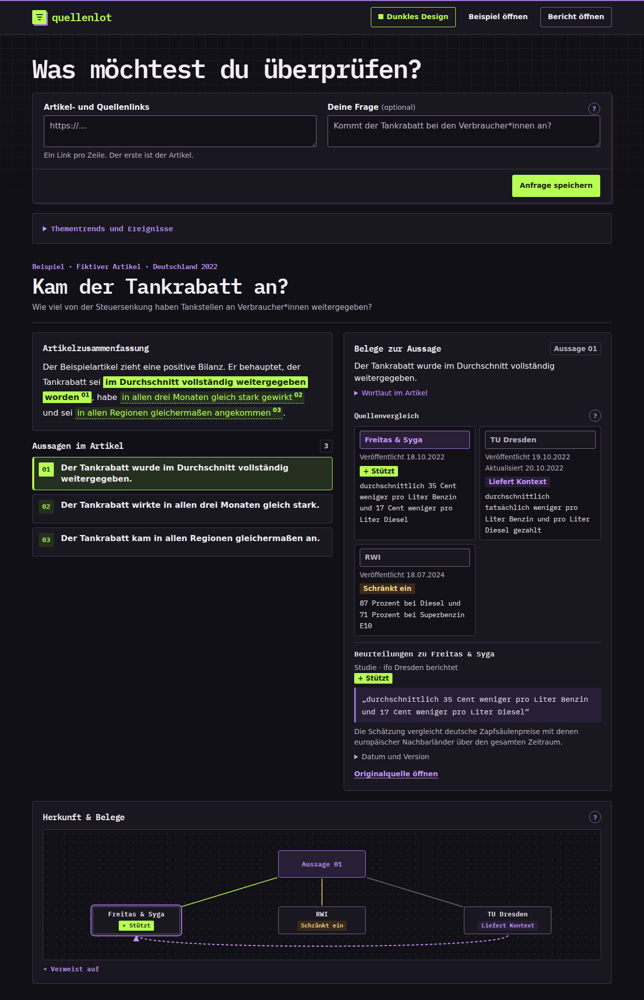
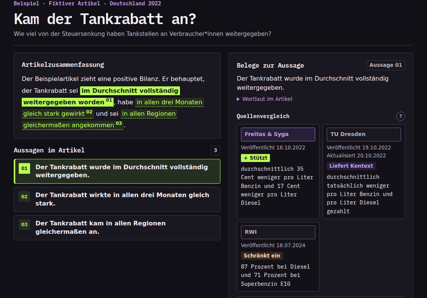

# Quellenlot

Quellenlot runs an evidence-first, multi-model review over supplied source snapshots or public article URLs. Inference runs locally through Ollama and requires no cloud model API, account, or API key.

## GUI preview

Open `web/index.html` to explore the Tankrabatt case. Select a highlighted claim to inspect its source passage and follow the citation from a report to the study it uses.



<details>
<summary>Watch the claim-to-source walkthrough</summary>



</details>

[GUI guide and mobile preview](web/README.md) · [Capture provenance](docs/images/generated/manifest.json)

## Workflow

1. Supply an explicit claim or an original article. In article mode, the first model that returns a valid extraction supplies up to five distinct claims anchored to exact quotes. An optional question guides claim selection.
2. Five distinct configured local models independently assess each claim against the supplied source snapshots. Successful models cross-review another model's assessment.
3. A deterministic report preserves disagreements, missing model responses, source versions, and quote-verification results. It does not turn model votes into a truth score.
4. In article mode, five local models independently prepare editorial notes for claims that have verified comparison excerpts. The report also lists claims the notes could not cover.

Models run sequentially. Each Ollama request sets `keep_alive=0` so Ollama unloads that model after the response; only one model needs to be resident at a time. The context is capped at 8,192 tokens by default and can be raised to 16,384. CPU inference is supported, but generation on a laptop CPU can be slow. The largest example model download is about 18 GB; its context cache and the OS also use RAM, so actual peak memory depends on the machine and request length.

The example pool is a starting point, not a validated ranking. It lists Qwen3.8 27B, gpt-oss 20B, Mistral Small 3.2 24B, Gemma 4 12B, and Ministral 3 14B. All run as local weights through Ollama. Model weights are downloaded once; after that, inference can run offline. The license differs by model; check each model card before redistribution or commercial deployment.

## Quick start

Requires Python 3.12+ and a running local Ollama server.

```bash
python -m venv .venv
. .venv/bin/activate
python -m pip install -e .
cp config.example.toml models.toml
```

Pull the models listed in `models.toml` (the first download requires internet access). Then prepare an input JSON:

```json
{
  "case_id": "tankrabatt-001",
  "claim": "The fuel tax cut was fully passed on to consumers.",
  "sources": [
    {
      "source_id": "article-a",
      "version_id": "2026-11-18T09:00:00Z",
      "title": "Example source",
      "url": "https://example.org/article",
      "captured_at": "2026-11-18T09:00:00Z",
      "text": "Paste the relevant source text here.",
      "text_is_complete": true
    }
  ]
}
```

Run the analysis:

```bash
quellenlot-agents --config models.toml --input case.json --output report.json
```

A quote match proves only that the text appears in the supplied snapshot, not that it supports the reasoning. A failed model produces a partial report. Fewer than two successful analyses cannot produce peer review. If every model fails, the command exits nonzero.

### Article input

Use the same CLI command with JSON containing an `article` instead of an explicit `claim`. You can omit the question and submit just the article. To compare sources, add a `comparison_sources` array of snapshots using the same fields as `article`. Source IDs must be unique.

```json
{
  "case_id": "bibliothek-001",
  "article": {
    "source_id": "meldung",
    "version_id": "v1",
    "title": "Neue Bibliothek",
    "url": "https://example.org/meldung",
    "captured_at": "2026-11-18T09:00:00Z",
    "text": "Die Bibliothek öffnet am Montag. Der Eintritt ist frei.",
    "text_is_complete": true
  },
  "question": "Wann öffnet die Bibliothek?",
  "comparison_sources": [
    {
      "source_id": "stadt",
      "version_id": "v1",
      "title": "Information der Stadt",
      "url": "https://example.org/stadt",
      "captured_at": "2026-11-18T09:15:00Z",
      "text": "Die Bibliothek öffnet am Dienstag.",
      "text_is_complete": false
    }
  ]
}
```

Article reports can include an `article_summary` of up to three sentences drafted during claim extraction. Each sentence carries the ID of a distinct claim with a verified article quote. This is a summary of what the article says. A verified quote establishes that the passage appears in the article snapshot. The comparison and review results give the evidence assessment.

Each claim entry contains the original quote, a source comparison in input order, and the detailed review. The comparison groups judgments by source and links exact-match citations to the supplied URL and snapshot version. A judgment may have no exact-match citation. Incomplete snapshots are marked unassessable when a model would otherwise report an omission.

The detailed review holds the claim text, model disagreements, and peer review records. A peer review is successful only when it covers every assigned finding exactly once. If extraction finds no claims, the article report has status `no_claims`. An article run can make up to ten model calls per extracted claim after extraction. Keep source snapshots short enough for the configured context length.

Sources record optional `published_at` and `updated_at` separately from `captured_at`. A manually supplied snapshot can include `"published_at": {"value": "2024-04-02"}`. Use an ISO date or timestamp and include the UTC offset when known. Missing dates are represented as `null`. The extraction, comparison, and peer-review prompts use the dates as context for time-sensitive claims and distinguish them from the times of events described in the article.

### Article URLs

Pass the same command a case with `article_url` and optionally `comparison_urls` and `question`.

```json
{
  "case_id": "bibliothek-url-001",
  "article_url": "https://example.org/meldung",
  "question": "Wann öffnet die Bibliothek?",
  "comparison_urls": ["https://example.org/stadt"]
}
```

The CLI fetches public HTTP(S) pages on the default ports and extracts readable text from static HTML. Each snapshot records the final URL and capture time. The JSON report records each attempted URL under `retrievals` and puts the article comparison under `review`. Failed comparison fetches leave the remaining sources available for review and mark the overall report `partial`. If the original cannot be fetched, the CLI writes the retrieval failure and exits with code 2.

Fetched text is always marked as having unverified completeness. The retrieval report also flags observable limits such as restricted access, a partial HTTP response, fallback to page text, or snapshot clipping. Omissions from these snapshots are reported as `not_assessable`. Use the text input mode to supply a complete snapshot you have verified. URL intake works with server-rendered HTML. Pages that require login, JavaScript rendering, or another document format may need text input.

For fetched pages, Quellenlot records explicitly declared dates and their provenance. It checks Article JSON-LD (`datePublished` and `dateModified`), then Open Graph article metadata, then labeled `<time>` elements within the article. If the highest-priority available channel gives conflicting values for a date, that date is left unknown. Date-only values remain dates, and timestamps without a UTC offset retain their unspecified timezone.

Each successful `retrievals` entry embeds the saved, versioned text under `snapshot`. Failed entries retain an attempt timestamp and the failure detail. Review quotes refer to a snapshot by source and version ID. When a quote occurs exactly once, `start` and `end` give its zero-based character offsets in that text, with an exclusive end. URL reports contain the captured article text and should be shared accordingly.

The URL workflow follows visible links from the extracted article or main content. It follows up to two hops and makes up to eight additional retrievals, giving priority within each hop to URLs linked by several sources. Redirect aliases and common tracking parameters are resolved when grouping shared targets. A link to an inaccessible page remains visible in the report, and `provenance.limited` records when traversal or link extraction reached a cap. These article-level links document where one page points to another. Claim-level support is assessed separately in `review`. Import the URL report into the GUI to inspect shared link targets and the exact text of the links.

### Automatic comparison search

To discover comparison sources from an article URL, add a `[search]` section to `models.toml` and omit `comparison_urls` from the input JSON. Supply a trusted [SearXNG endpoint](https://docs.searxng.org/dev/search_api) with JSON enabled in its `search.formats` settings. A locally hosted instance works without an API key.

```toml
[search]
endpoint = "http://127.0.0.1:8888/search"
language = "de-DE"
max_sources = 3
```

Quellenlot searches the extracted claims and, if supplied, the question anchored to the first claim. The configured search instance and its upstream search providers receive these queries. The search samples up to 20 results per query, gives preference to government and public institution domains in a fixed list, then tries up to twice `max_sources` URLs to capture unique articles. This preference is based on the publisher's domain. The normal evidence review assesses each captured source and its quotes.

The report lists the executed queries under `discovery.queries`, shows attempted candidates and selection outcomes under `discovery.candidates`, and records individual fetch failures under `retrievals`. Search failures and searches with zero usable comparisons produce a partial report when the original can still be reviewed. Explicit comparison URLs take precedence whenever you supply them.

### Shared wording

Quellenlot compares the captured source text locally using RapidFuzz. The `shared_wording` field appears in the standalone claim report or once on the article report (`review.shared_wording` for a URL case). Each match contains excerpts from both source versions, their zero-based character offsets in those snapshots, and an ordered-token similarity score from 0 to 100. The ending offset is exclusive.

The matcher looks for lightly edited paragraphs, sentences, and quoted passages. It requires at least 12 tokens and a similarity score of 90. It samples up to 160 passage windows per source and reports up to three matches per source pair and 60 per case. The `limited` flag indicates when a candidate or reporting cap was reached.

Shared wording can come from syndication, attributed quotations, or a common press release. The report retains all source findings so that additions, changes in numbers or wording, and distinct reporting are visible. Source publication, update, and capture dates describe the available snapshots. Establishing who first published a particular passage requires dated versions of the passage itself.

### Claim-level source diff

Each claim review includes a `source_diff`. In a standalone claim report it is at the top level. In an article report it is under each `claims[].review`. The diff keeps sources in input order, with publication and update dates, independent model judgments, and references to their verified quotes in an evidence table.

The evidence table groups identical quotes from multiple sources when their occurrences are inside a matched passage. Source-specific excerpts and variants stay visible, including quotes that combine reused wording with additional reporting. A citation with a unique location in its snapshot includes zero-based character offsets and any overlapping `shared_wording_match_indexes`. These indexes refer to the standalone report's `shared_wording.matches` or to the enclosing article report's list. Repeated occurrences in a single source leave the exact offsets unknown.

Model disagreements remain visible as separate judgments. An incomplete snapshot yields `not_assessable` when a model would otherwise label a claim omitted. Each row's evidence references cover verified citations from source analysis. Peer-review evidence and retrieval outcomes remain available in the detailed report.

### Publisher and author relationships

Set `check_interests = true` in the top-level `models.toml` configuration to run a separate interests investigation. When a SearXNG `[search]` section is configured, Quellenlot searches each available source's declared publisher and up to two named authors for ownership, funding, and affiliations. It captures up to three evidence pages per source, keeps the queries and retrieval outcomes, and asks all five local models to assess their contents sequentially. Without a search endpoint, the report records missing evidence.

Article inputs may also supply an `interest_evidence` list with `target_source_id` and a full `source` snapshot. URL inputs accept `interest_urls`, each with a `target_source_id` and `url`. For URL cases, use `article` for the original or an ID such as `comparison-1` for a supplied comparison URL. Explicit interest evidence is used in place of automatic discovery for that source.

The `interests` section of the article report records source metadata, retrieved evidence versions, search attempts, and each model's findings about ownership, funding, author affiliations, and political affiliations. Every reported relationship must cite an exact passage in an evidence snapshot that names both parties. Each model and source also lists categories that remain unresolved. A model failure remains visible. An exact quote match establishes that the text appears in the captured evidence. The reviewer still needs to verify the relationship and its editorial significance.

### Final editorial assessment

Article cases include an `editorial` section. For each claim it lists the verified comparison evidence IDs, sources without verified quotes, the underlying review status, and the number of unresolved disagreements. It links to the separate interests report by source ID and records incomplete snapshots and URL retrieval or discovery gaps.

When at least one claim has verified comparison excerpts, each of the five models receives up to three passages per eligible claim, with preference for covering conflicting, qualifying, and supporting judgments. The input marks shared wording, clipped excerpts, dates, and examples of unresolved dissent. Each model returns one note per eligible claim with evidence references and a follow-up check where warranted. The selected source findings have stable IDs. The model must return one outcome and explanation for each assigned finding. Missing, repeated, and foreign IDs or citations invalidate the response. The report records how many comparison findings stayed outside the editorial selection, carries the original dissent into the editorial coverage, and flags findings challenged or left unclear by any final reviewer. The source diff retains all model findings and verified excerpts.

The editorial status describes assessment coverage. Unresolved disagreements remain visible even when every assigned finding was reviewed. It is `complete` when every claim has comparison evidence, all five notes are available, and the earlier review, search, and retrieval stages finished without reported failures. An article with no verified comparison excerpt gets `no_comparison_evidence` and skips the additional model calls. The notes ask a human editor to verify interpretations and source independence before making any publication decision.

## Development checks

```bash
python -m pip install -e ".[dev]"
pre-commit install
pre-commit run --all-files
python -m unittest discover -s tests -v
pip-audit
python -m build
twine check dist/*
```

GitHub Actions runs the full suite on pushes, pull request updates, merge-queue events, and manual runs. The checks cover every tracked Python source and stub, including tests and tooling, without a changed-file baseline or CI auto-fixes.

- Ruff enforces linting, formatting, annotations, and Google-style docstrings. The documentation contract checks descriptive summaries and applicable `Args`, `Returns`, `Yields`, and `Raises` sections for public APIs. It rejects explicit generic annotations and inline diagnostic suppressions.
- Pyright runs in strict mode with warnings treated as failures. Astral's ty enables every rule as an error.
- CrossHair checks exact peer-review coverage and how the workflow handles apparent omissions in incomplete sources. The symbolic coverage check uses assignments of up to three findings. Import Linter enforces the package layers, and Vulture checks high-confidence dead code.
- Actionlint, Zizmor, and Yamllint validate workflow definitions. CI also runs Bandit, the dependency audit, deterministic behavioral tests with fixture HTML and simulated Ollama responses, and the package build checks.

## Scope boundary

Quellenlot includes a local agent library, a CLI, and a loopback browser interface with local run history and a private editorial checklist. Run `quellenlot-ui --config models.toml` from the checkout to start an analysis from the browser. See the [GUI guide](web/README.md#using-the-local-agent) for setup and storage paths. Hosted access control and public publication remain separate work. Local model quality for German political research still needs evaluation against a held-out set before relying on the results.
